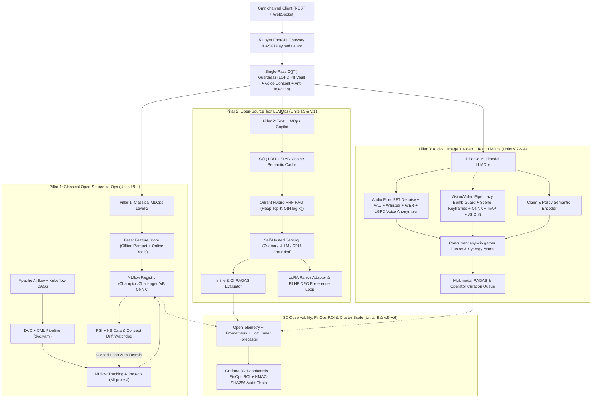

# OmniPulse AI — Enterprise MLOps, LLMOps & Multimodal LLMOps Platform 🚀🎙️🎥🧠


> **Industrial Reference Architecture** operationalizing **100% of the open-source ecosystem, maturity levels, statistical drift governors, container/cluster patterns, and generative multimodal pipelines** from *Machine Learning Operations (MLOps) and Solutions Infrastructure* (Oliveira & Amorim, AKCIT / CEIA / UFG, 2026).

**OmniPulse AI** unifies **Three Production Pillars** inside one enterprise omnichannel risk, policy copilot, and multimodal dispute inspection platform:
1. **Pillar 1 — Classical MLOps Level-2 Engine (`app/mlops/`)**: **Feast** Feature Store (Offline **Apache Parquet** + Online **Redis** with $\mathcal{O}(Q \log M)$ point-in-time joins eliminating *data leakage* and *training-serving skew*), **DVC** (`dvc.yaml`, `params.yaml`) + **CML** pull-request reports, **MLflow** (Tracking, `MLproject`, ONNX Models, Model Registry `Staging` / `Production` / `Archived` + Champion/Challenger A/B routing), **Apache Airflow** & **Kubeflow Pipelines** DAGs, and **PSI + Kolmogorov-Smirnov Data/Concept Drift** monitoring with closed-loop **automated retraining**.
2. **Pillar 2 — Open-Source Text LLMOps Engine (`app/llmops/`)**: SHA-256 **Prompt & Quantized Checkpoint Registry** (`FP16`/`INT8`/`INT4` VRAM & GPU shard planner), $\mathcal{O}(1)$ `OrderedDict` LRU + BLAS Cosine **Semantic Cache**, single-pass $\mathcal{O}(|T|)$ reversible **LGPD/GDPR PII Vault** + anti-injection + **Toxicity** guardrails, **Qdrant** Hybrid Dense + Lexical RRF **RAG** (`heapq.nlargest` $\mathcal{O}(N \log K)$), self-hosted open-source serving adapters (**Ollama** / **vLLM** / local deterministic CPU synthesizer), inline **RAGAS** evaluation, and parameter-efficient **LoRA** ($\Delta W = B A$) + **RLHF/DPO** continuous preference adaptation.
3. **Pillar 3 — Multimodal LLMOps Engine (`app/multimodal/`)**: Concurrent `asyncio.gather` ingestion, synchronization, and cross-modal inference across **Text + Audio + Image + Video** — featuring FFT spectral denoising, frame-energy **VAD**, **SNR (dB)**, open-source **Whisper** ASR, rolling-row DP **WER**, **LGPD** biometric voice anonymization, lazy `PIL` decompression-bomb guard, temporal stride + L1 scene-delta **Video Keyframe Extraction**, **ONNX Runtime** inference + INT8 quantization profiling, **IoU / mAP**, RGB **Jensen-Shannon Visual Drift**, **Cross-Modal Synergy & Modality-Collapse Detection**, and **Multimodal RAGAS**.

---

## 🧭 System Architecture & 3-Pillar Topology



---

## 📚 Book-to-Code Traceability Matrix

| Book Unit | Core Engineering Concepts & Figures | Open-Source Tools & Modules Implemented |
| :--- | :--- | :--- |
| **Unit I** | DevOps vs DataOps vs MLOps, Maturity Levels $0 \to 1 \to 2$ (Fig. 5), Data Value Chain & Negative ROI Risk (Fig. 17), LLMOps Foundations | `DriftRetrainingEngine.assess_maturity_level`, `FinOpsROIEngine` (`app/core/finops_roi.py`), `HoltLinearForecaster`, **MLflow**, **Kubeflow**, **Airflow**, **DVC**, **GitHub Actions**, **GitLab CI**, **Jenkins**, **Prometheus**, **Grafana** |
| **Unit II** | 3-Stage ML CI/CD (Fig. 18), 4 MLflow Components (Fig. 19), DVC + CML PR Reports (Fig. 20), Airflow DAG Sync (Fig. 21), Feast Offline/Online Feature Store | `app/mlops/mlflow_lifecycle.py`, `MLproject`, `dvc.yaml`, `params.yaml`, `app/mlops/dvc_pipeline.py`, `feature_repo/feature_store.yaml`, `feature_repo/features.py`, `app/mlops/feast_store.py`, `dags/omnipulse_mlops_dag.py` |
| **Unit III** | Multi-stage Containerization, K8s Control Plane / Worker Nodes, Load Balancing & Peak-Load Autoscaling (Fig. 27–30) | `Dockerfile`, `docker-compose.yml` (6-service stack), `k8s/deployment.yaml`, `k8s/service.yaml`, `k8s/hpa.yaml` (**HPA**), `k8s/vpa.yaml` (**VPA**), `k8s/kubeflow_pipeline.yaml` |
| **Unit IV** | 5-Layer Predictive Service Architecture: Request $\to$ Validation $\to$ Inference $\to$ Response + Parallel Telemetry Logs (Fig. 31) & Streaming | `app/main.py`, `app/api/schemas.py` (`frozen=True` Pydantic v2), `app/api/routes.py`, OpenAPI `/docs`, real-time `WEBSOCKET /ws/v1/multimodal/stream` |
| **Unit V** | Generative Deploy: LLMs (Fig. 32), Vision/Video (Fig. 33), Audio/Whisper (Fig. 34), Multimodal Synergy (Fig. 35), Cost/FinOps & 3D Observability (Fig. 36–38) | `app/llmops/*` (**Qdrant**, **Ollama**, **RAGAS**, **LoRA**/RLHF), `app/multimodal/audio_pipeline.py` (**Whisper**, VAD, SNR, WER, LGPD Voice), `app/multimodal/vision_video_pipeline.py` (**ONNX Runtime**, Keyframes, mAP, JSD Drift), `app/multimodal/fusion_engine.py`, `app/core/observability.py` |

---

## 📐 Mathematical Formulations Implemented

### 1. Population Stability Index ($\text{PSI}$) & Kolmogorov-Smirnov Data Drift (Pillar 1)
Across $B$ reference quantile bins with smoothed empirical proportions $p_b$ (reference) and $q_b$ (live traffic):

$$\text{PSI}(P, Q) = \sum_{b=1}^{B} \left(q_b - p_b\right) \ln\left(\frac{q_b}{p_b}\right), \qquad D_{\text{KS}} = \sup_{x} \left| F_{\text{ref}}(x) - F_{\text{cur}}(x) \right|$$

When $\text{PSI} \ge 0.20$, $(p_{\text{KS}} < 0.05 \land D_{\text{KS}} \ge 0.15)$, or live accuracy drops below the Concept Drift SLO, `DriftRetrainingEngine` automatically trains a Challenger ONNX model, verifies registry gates, and promotes it to `Production`.

### 2. Low-Rank Adaptation ($\text{LoRA}$) & Direct Preference Margin Update (Pillar 2)
Keeping pre-trained weights $W_0 \in \mathbb{R}^{d_{\text{out}} \times d_{\text{in}}}$ strictly frozen, trainable low-rank matrices $A \in \mathbb{R}^{r \times d_{\text{in}}}$ and $B \in \mathbb{R}^{d_{\text{out}} \times r}$ ($r \ll \min(d_{\text{in}}, d_{\text{out}})$) parameterize continuous RLHF updates:

$$h(x) = W_0 x + \frac{\alpha}{r} B A x, \qquad \mathcal{L}_{\text{pref}}(\theta_{\text{LoRA}}) = -\mathbb{E}_{(x, y^+, y^-)} \left[ \ln \sigma\!\left( \langle h(x),\, e(y^+) - e(y^-) \rangle \right) \right]$$

### 3. Reciprocal Rank Fusion ($\text{RRF}$) & RAGAS Faithfulness (Pillar 2)
Hybrid dense cosine + lexical overlap rankings $r_{\text{dense}}(d)$ and $r_{\text{lex}}(d)$ are fused via `heapq.nlargest` in $\mathcal{O}(N \log K)$, and generated answers decomposed into atomic claims $\mathcal{C}(a)$ are scored for contextual faithfulness:

$$\text{RRF}(d) = \frac{1}{k + r_{\text{dense}}(d)} + \frac{1}{k + r_{\text{lex}}(d)}, \qquad \text{Faithfulness}(a, C) = \frac{1}{|\mathcal{C}(a)|} \sum_{c \in \mathcal{C}(a)} \frac{|\mathcal{T}(c) \cap \mathcal{T}(C)|}{|\mathcal{T}(c)|}$$

### 4. Acoustic Signal-to-Noise Ratio ($\text{SNR}_{\text{dB}}$) & Rolling-Row $\text{WER}$ (Pillar 3 — Audio)
Using vectorized frame-energy Voice Activity Detection ($\text{VAD}$) and 2-row Levenshtein dynamic programming ($S$ substitutions, $D$ deletions, $I$ insertions over $M$ reference words):

$$\text{SNR}_{\text{dB}} = 10 \log_{10}\!\left(\frac{\mathbb{E}_{t \in \text{VAD}}[x_t^2]}{\mathbb{E}_{t \notin \text{VAD}}[x_t^2]}\right), \qquad \text{WER} = \frac{S + D + I}{M}$$

### 5. Bounding-Box $\text{IoU}$, $\text{mAP}$, and Visual Jensen-Shannon Drift (Pillar 3 — Vision & Video)
Across RGB channel histograms $P_c, Q_c$ with midpoint mixture $M_c = \frac{1}{2}(P_c + Q_c)$:

$$\text{IoU}(B_p, B_g) = \frac{|B_p \cap B_g|}{|B_p \cup B_g|}, \qquad D_{\text{JS}}(P \parallel Q) = \frac{1}{6} \sum_{c \in \{R,G,B\}} \left[ D_{\text{KL}}(P_c \parallel M_c) + D_{\text{KL}}(Q_c \parallel M_c) \right] \in [0, 1]$$

### 6. Cross-Modal Synergy ($S_{\text{mm}}$) & Continuous FinOps $\text{ROI}$ (Pillar 3 & Governance)
Given L2-normalized embeddings $\{z_m\}_{m=1}^{M}$ across $M = 4$ modalities (`text`, `audio`, `image`, `video`) and optimized infrastructure costs:

$$S_{\text{mm}} = \frac{2}{M(M - 1)} \sum_{1 \le i < j \le M} \max\!\left(0,\, z_i^\top z_j\right), \qquad \text{ROI} = \frac{V_{\text{business}} - \left(C_{\text{compute}}^{\text{INT4,cache,HPA}} + C_{\text{storage}}^{\text{Parquet}} + C_{\text{retrain}}\right)}{C_{\text{total}}^{\text{opt}}}$$

---

## ⚡ Algorithmic Complexity & Runtime Guarantees

| Subsystem | Module | Algorithm / Data Structure | Time Complexity | Space Complexity |
| :--- | :--- | :--- | :---: | :---: |
| **Rate Limiter & Circuit Breaker** | `app/core/resilience.py` | Fractional Token Bucket + Tri-State `RLock` FSM | $\mathcal{O}(1)$ | $\mathcal{O}(1)$ |
| **PII Scrubber & Reversible Vault** | `app/llmops/guardrails.py` | Compiled single-pass alternation regex | $\mathcal{O}(\|T\|)$ | $\mathcal{O}(E)$ |
| **Tamper-Evident Audit Chain** | `app/core/observability.py` | Canonical JSON array HMAC-SHA256 hash chain | $\mathcal{O}(1)$ append / $\mathcal{O}(M)$ verify | $\mathcal{O}(M)$ |
| **Time-Series Metric Forecaster** | `app/core/observability.py` | Bounded `deque` Holt double-exponential smoothing | $\mathcal{O}(1)$ | $\mathcal{O}(W)$ |
| **Feast Point-in-Time Join** | `app/mlops/feast_store.py` | Sorted entity timeline + `bisect_right` lookup | $\mathcal{O}(Q \log M)$ | $\mathcal{O}(N)$ |
| **Feast Online Feature Lookup** | `app/mlops/feast_store.py` | Redis / `RLock` hash map entity read | $\mathcal{O}(1)$ | $\mathcal{O}(E)$ |
| **Semantic Cache** | `app/llmops/semantic_cache.py` | Tier-1 `OrderedDict` LRU + Tier-2 BLAS matrix dot | $\mathcal{O}(1)$ exact / $\mathcal{O}(C \cdot D)$ cosine | $\mathcal{O}(C \cdot D)$ |
| **Hybrid RRF Vector RAG** | `app/llmops/rag_engine.py` | SIMD dense + lexical fusion + `heapq.nlargest` | $\mathcal{O}(N \cdot D + N \log K)$ | $\mathcal{O}(N \cdot D)$ |
| **Word Error Rate (WER)** | `app/multimodal/audio_pipeline.py` | Rolling 2-row Wagner-Fischer DP | $\mathcal{O}(M \cdot N)$ | $\mathcal{O}(\min(M, N))$ |
| **Video Keyframe Extractor** | `app/multimodal/vision_video_pipeline.py` | Vectorized stride + L1 frame-delta spike detector | $\mathcal{O}(F \cdot H \cdot W)$ | $\mathcal{O}(K \cdot H \cdot W)$ |
| **Production Traffic Simulator** | `app/simulator.py` | Bounded `deque(maxlen=H)` + `RLock` + `asyncio.Event` | $\mathcal{O}(1)$ append / wakeup | $\mathcal{O}(H)$ |

---

## 🚀 Quickstart

### 1. Local Hermetic Environment (`uv` + Python 3.12)

```bash
uv venv .venv --python 3.12 --seed
uv pip install --python .venv/bin/python -e ".[dev]"

# Run static checks, strict typing, and full test suite (>= 95% coverage gate)
.venv/bin/ruff check app tests dags feature_repo
.venv/bin/mypy app dags feature_repo
.venv/bin/pytest tests -v --cov=app --cov-report=term-missing --cov-fail-under=95

# Execute the 6-stage DVC + Feast + MLflow ONNX pipeline via CLI
.venv/bin/python -m app.mlops.dvc_pipeline

# Start the 5-Layer FastAPI + WebSocket server
.venv/bin/uvicorn app.main:app --host 0.0.0.0 --port 8017
```

### 2. Full 6-Container Open-Source Stack (Docker Compose)

```bash
docker compose up --build -d
```

Exposed Platform Endpoints:
- **OmniPulse FastAPI + Swagger UI**: `http://localhost:8017/docs`
- **WebSocket Multimodal Live Stream**: `ws://localhost:8017/ws/v1/multimodal/stream`
- **MLflow Tracking & Model Registry UI**: `http://localhost:5005`
- **Feast Online Store (Redis)**: `localhost:6385`
- **Qdrant Vector Engine**: `http://localhost:6339`
- **Prometheus Metrics & Drift Alerts**: `http://localhost:9095`
- **Grafana 3D Observability Dashboard**: `http://localhost:3009` (`admin` / `omnipulse-admin`)

### 3. Kubernetes Cluster Deployment (HPA + VPA + Kubeflow)

```bash
kubectl create namespace mlops-prod
kubectl apply -f k8s/deployment.yaml -f k8s/service.yaml -f k8s/hpa.yaml -f k8s/vpa.yaml
```

### 4. Continuous Synthetic Production Traffic Simulator

Run realistic synthetic production traffic continuously across all 3 pillars (Feast + ONNX scoring, periodic PSI Data Drift waves with auto-retraining, RAG + SIMD Cache + LGPD PII redaction + Guardrail prompt-injection blocks + LoRA DPO steps, and consistent vs. contradictory Audio/Image/Video inspections) to observe live JSON logs, Prometheus `/metrics`, Grafana dashboards, and the HMAC-SHA256 audit chain:

```bash
# Option A — Self-contained live terminal stream (in-process engine)
make simulate

# Option B — External HTTP + WebSocket load client against a running server (port 8017)
make simulate-api

# Option C — Control the background loop inside FastAPI / Docker Compose via REST + SSE
curl -X POST http://localhost:8017/api/v1/simulate/start \
  -H "Content-Type: application/json" \
  -d '{"interval_seconds": 1.0, "drift_wave_every": 8}'

curl -N http://localhost:8017/api/v1/simulate/stream
curl http://localhost:8017/api/v1/simulate/status
curl -X POST http://localhost:8017/api/v1/simulate/stop
```

---

## 🔌 API Reference Summary

| Method & Route | Pillar | Description |
| :--- | :---: | :--- |
| `POST /api/v1/mlops/pipeline/run` | **MLOps** | Runs declarative `dvc.yaml` stages, Feast materialization, MLflow ONNX registration & CML report |
| `POST /api/v1/mlops/predict` | **MLOps** | $\mathcal{O}(1)$ Feast Online Store lookup + deterministic Champion/Challenger A/B ONNX risk scoring |
| `POST /api/v1/mlops/drift/evaluate` | **MLOps** | Evaluates $\text{PSI} + D_{\text{KS}}$ Data Drift & Concept Drift with closed-loop auto-retraining |
| `POST /api/v1/llmops/chat` | **LLMOps** | Guardrails $\to$ Semantic Cache $\to$ Qdrant Hybrid RAG $\to$ Open-Source LLM $\to$ Inline RAGAS |
| `POST /api/v1/llmops/adapt/lora` | **LLMOps** | Buffers RLHF human preference tuple and runs rank-$r$ LoRA DPO adaptation epochs |
| `POST /api/v1/multimodal/inspect` | **Multimodal** | Concurrent `asyncio.gather` Text + Audio + Image + Video fusion, Synergy & Multimodal RAGAS |
| `WS /ws/v1/multimodal/stream` | **Multimodal** | Low-latency streaming Whisper utterance transcription + real-time ONNX frame classification |
| `GET /api/v1/observability/summary` | **3D Obs** | Infrastructure, Holt throughput/drift forecasts, and statistical/semantic quality telemetry |
| `GET /api/v1/finops/roi` | **FinOps** | Quantifies INT4 + Semantic Cache + HPA + Parquet savings and flags Negative ROI risk |
| `GET /api/v1/audit/verify` | **Security** | Verifies canonical HMAC-SHA256 cryptographic audit chain integrity in $\mathcal{O}(M)$ |
| `POST /api/v1/simulate/{start,stop}` | **Simulator** | Starts, updates cadence, or stops the non-blocking continuous 3-pillar production loop |
| `GET /api/v1/simulate/{status,stream}` | **Simulator** | Returns bounded $\mathcal{O}(1)$ simulator counters or streams live ticks over SSE (`text/event-stream`) |
| `GET /metrics` & `GET /health` | **Ops** | OpenMetrics Prometheus scrape endpoint & Kubernetes readiness/liveness probe |

---

## 📄 License

Released under the [MIT License](LICENSE). Developed by **Cayo Eduardo**.
